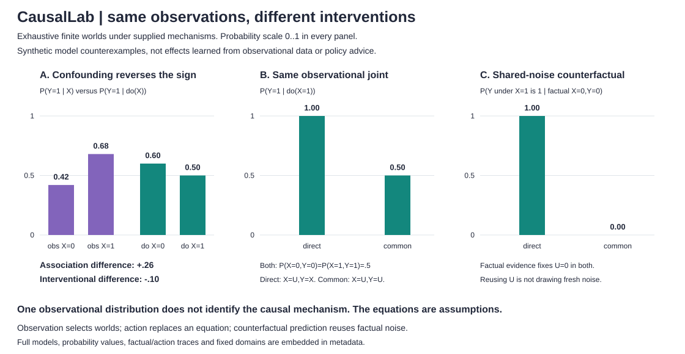

# CausalLab

**The same observations can hide different interventions.** An exact finite structural-causal-model engine with separate observational, interventional and shared-noise counterfactual queries. Dependency-free Python 3.10+, strict JSON/CLI, inspectable noise-world traces and exhaustive reference tests.



This project computes consequences of **supplied synthetic mechanisms**. It does not learn causes from data, discover a graph, identify an effect automatically, estimate a medical treatment effect or recommend policy. "Exact" means exhaustive discrete enumeration in floating point, not symbolic exact arithmetic or real-world certainty.

## Run locally

From the repository root, no installation or data download needed:

```sh
python -m unittest discover -s tests -v
python -m causallab demo > /tmp/causal-demo.json
python examples/render_demo.py /tmp/causal-demo.json --check
python -m causallab query examples/confounded.json --query Y --evidence X=1
python -m causallab query examples/confounded.json --query Y --do X=1
python -m causallab counterfactual examples/common.json --query Y --evidence X=0,Y=0 --do X=1 --trace
python -m causallab query --help
```

Output is JSON. Invalid inputs or impossible evidence exit 2 with a prefixed stderr error, no partial stdout and no traceback. The CLI rejects duplicate JSON keys and limits files to 262,144 bytes. API: `from causallab import Model, infer`; `infer(model, ['Y'], evidence={'X': 0}, interventions={'X': 1}, counterfactual=True, trace=True)`.

## Three different operations

| Operation | What it changes | Evidence means |
|---|---|---|
| Observation, `query` without `--do` | Selects compatible original noise worlds | Original observed endogenous values |
| Intervention, `query --do X=1` | Replaces X's entire equation by the constant 1 | Post-action values, if `--evidence` is supplied |
| Counterfactual, `counterfactual --do X=1` | First selects factual worlds, then replaces X's equation and reuses their noise | Factual values in the **unmodified** model |

For a counterfactual, abduction updates the posterior over complete exogenous assignments. Action changes the equation, not that posterior. Prediction evaluates the changed model with each same assignment. It does **not** draw fresh noise or multiply the factual evidence probability twice.

An ordinary query with evidence X=0 and do(X=1) is impossible, so it errors. A counterfactual with factual X=0 and do(X=1) can be well-defined: these statements belong to different worlds. [Algorithm, resource accounting, numerical limits and tests](DESIGN.md).

## A positive association with a negative intervention difference

The first fixture has 100 equally weighted noise worlds. Binary Z describes a context that affects both action X and outcome Y. X=1 is more common in the favorable context. By construction, switching X from 0 to 1 lowers outcome probability in **both** contexts.

| Quantity | X=0 | X=1 | Difference, 1 minus 0 |
|---|---:|---:|---:|
| P(Y=1 given observed X) | .42 | .68 | +.26 |
| P(Y=1 given do(X)) | .60 | .50 | -.10 |
| P(Y=1 given X, Z=0) | .90 | .80 | -.10 |
| P(Y=1 given X, Z=1) | .30 | .20 | -.10 |

Summing stratum outcome probabilities against P(Z) gives .60/.50, matching intervention enumeration. The raw association uses different Z compositions. This is an intentionally constructed confounding example, not an empirical estimate or claim about a real action. No noise levels, thresholds or seeds were searched; there is no sampling RNG.

## One observed joint, two causal mechanisms

Both models use U~Bernoulli(.5), X=U. The direct model sets Y=X; the common-input model sets Y=U. Both have exactly P(X=0,Y=0)=P(X=1,Y=1)=.5, with off-diagonal probability zero.

| Query | Direct, Y=X | Common input, Y=U |
|---|---:|---:|
| P(Y=1 given observed X=1) | 1 | 1 |
| P(Y=1 given do(X=1)) | 1 | .5 |
| P(Y would be 1 under X=1, given factual X=0,Y=0) | 1 | 0 |

The last query fixes factual U=0. Setting X=1 then changes Y only in the direct model. In the common-input model, drawing fresh U would give .5 instead of the correct model-conditional 0. The same observational joint therefore does not determine these queries without further mechanism assumptions. The engine is **not** choosing between those assumptions from data.

## Model format

Each named exogenous variable has a categorical distribution. Distinct exogenous variables are assumed independent; multiple equations may use the **same** named variable, which creates a shared latent cause. Nodes are supplied in topological order as deterministic truth tables. An input may name an exogenous variable or an earlier endogenous node.

```json
{
  "version": 1,
  "exogenous": [{"name": "U", "probabilities": [0.5, 0.5]}],
  "nodes": [
    {"name": "X", "states": 2, "inputs": ["U"], "table": [0, 1]},
    {"name": "Y", "states": 2, "inputs": ["X"], "table": [0, 1]}
  ]
}
```

States are integers starting at 0. The **last input changes fastest** in the flattened table. For inputs of cardinalities 2 and 3, order is (0,0),(0,1),(0,2),(1,0),(1,1),(1,2). An empty input list has a one-entry constant table. Cycles, forward references, repeated inputs/names, wrong dimensions, booleans as numbers, non-finite probabilities and unknown fields are rejected.

## Inspect the result

Each query returns the full requested joint, including impossible combinations with probability 0 and `log_probability: null`. A possible but extremely rare combination can have probability 0 by floating-point underflow while its log probability stays finite. Rare evidence is normalized in log/relative space, not mistaken for an impossible event.

Results include the normalized model's SHA-256, query mode, variables/evidence/actions, evidence mass/log mass, Cartesian world slots, positive-prior and matching world counts, and actual factual/action model-evaluation counts. Optional traces retain each matching noise assignment, its log prior and posterior probability, and factual/post-action versus predicted endogenous values. Query evidence mass is post-action; counterfactual evidence mass is factual. The hash is an identity checksum, not proof of mechanism validity.

## Bounds, tests and limits

- 1..8 independent exogenous variables, each with 2..16 states; their Cartesian product is capped at **65,536 worlds**, including zero-probability slots.
- 1..12 endogenous nodes, each with 2..4 states and at most 8 inputs. Each table has at most 4,096 entries; all tables together at most 16,384.
- Query 1..8 unique endogenous variables, with at most 4,096 joint rows. Assignment values must be valid integers. Exogenous values cannot be queried, observed or intervened on through this API.
- Traces additionally cap `world_slots * node_count * (2 if counterfactual else 1)` at 32,768. This is a conservative output/work bound, not a count of actual matched worlds.
- Exhaustive work scales with world slots and equation/input count, not just number of returned rows. Finite models can still grow exponentially. [Detailed accounting](DESIGN.md).

**38 tests** include independent rational enumeration of the 100-world fixture, all 64 tiny Boolean mechanism pairs, intervention and counterfactual consistency, exact observational equivalence with different interventions, nonbinary table ordering, factual-noise reuse, posterior-trace reconstruction, underflowed rare evidence, zero support, input/RNG isolation, strict CLI errors and resource preflight. Every plotted bar value/coordinate, all model/trace metadata and byte-identical SVG regeneration are checked. CI runs Python 3.10..3.13 plus the demo/figure checks.

No parameter learning, graph discovery, do-calculus identification, correlated exogenous-distribution syntax, cyclic equations, continuous variables, stochastic/soft interventions, joint multi-action-world queries, empirical confidence intervals or counterfactual fairness guarantee is implemented. Supplied structural couplings determine counterfactuals; observed conditional tables alone do not supply them. No private dataset, GPU, paid API or external service is used.

## Attribution

Independent implementation of standard finite structural-causal-model semantics. Technical reference: Judea Pearl, **"Causal and Counterfactual Inference," UCLA report R-485**, section 2 and equation 3, including abduction/action/prediction (2019 draft; 2021 handbook chapter). [Author-hosted primary source](https://ftp.cs.ucla.edu/pub/stat_ser/r485.pdf).

This repository's integer tables, algorithms, fixtures, tests and figure are its own. No source text, code, data or figures were copied. It does not reproduce the paper's empirical examples or implement its general identification results. MIT license.
