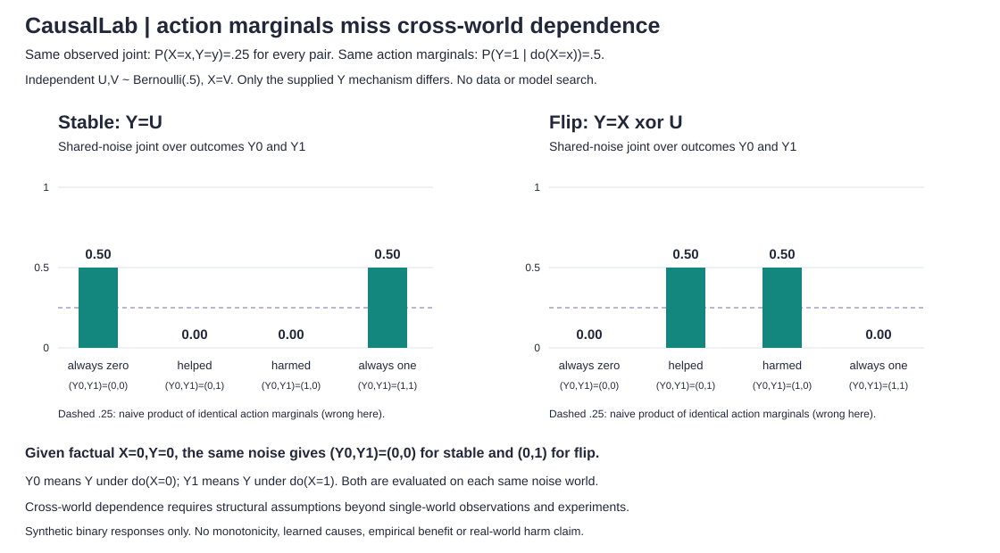
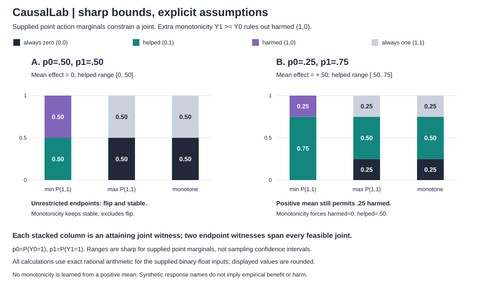
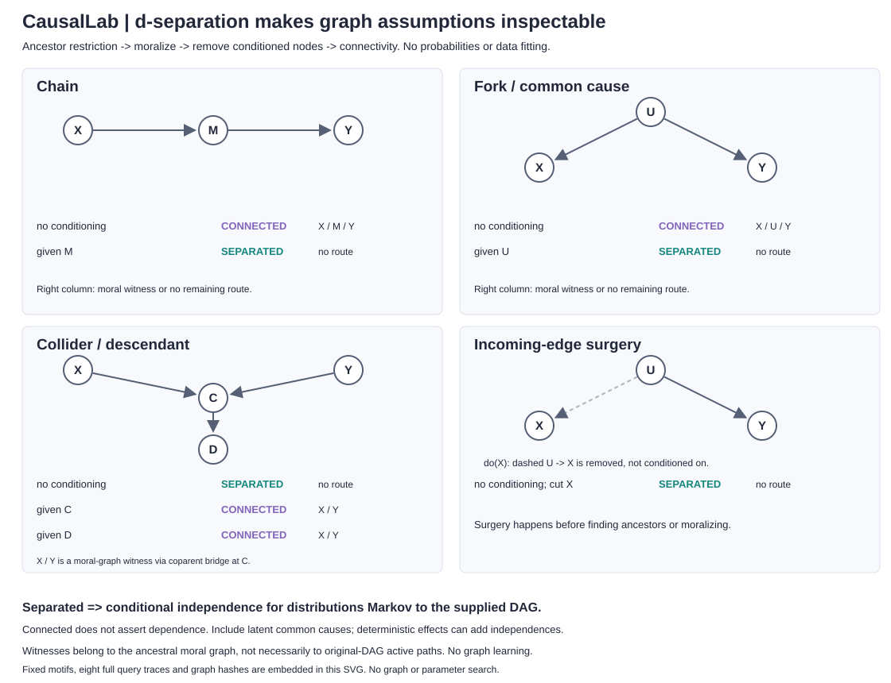
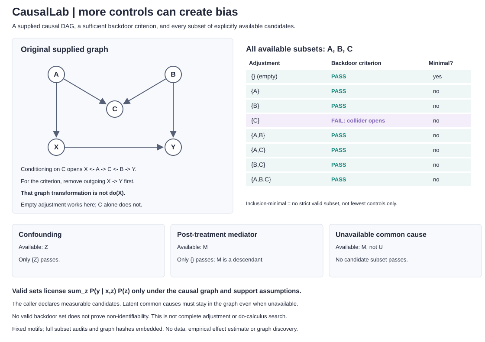
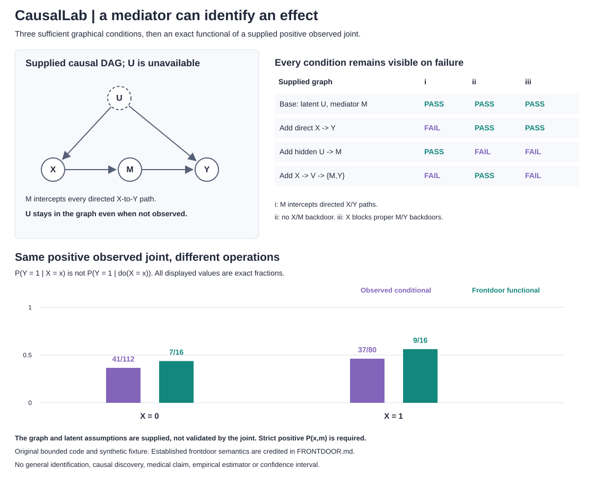

# CausalLab

**The same observations can hide different interventions.** An exact finite structural-causal-model engine with separate observational, interventional and shared-noise counterfactual queries. Dependency-free Python 3.10+, strict JSON/CLI, inspectable noise-world traces and exhaustive reference tests.


This project computes consequences of **supplied synthetic mechanisms**. It does not learn causes from data, discover a graph, identify an effect automatically, estimate a medical treatment effect or recommend policy. "Exact" means exhaustive discrete enumeration in floating point, not symbolic exact arithmetic or real-world certainty.

## Run locally

From the repository root, no installation or data download needed:

```sh
python -m unittest discover -s tests -v
python -m causallab demo > /tmp/causal-demo.json
python examples/render_demo.py /tmp/causal-demo.json --check
python -m causallab query examples/confounded.json --query Y --evidence X=1
python -m causallab query examples/confounded.json --query Y --do X=1
python -m causallab counterfactual examples/common.json --query Y --evidence X=0,Y=0 --do X=1 --trace
python -m causallab query --help
```

Output is JSON. Invalid inputs or impossible evidence exit 2 with a prefixed stderr error, no partial stdout and no traceback. The CLI rejects duplicate JSON keys and limits files to 262,144 bytes. API: `from causallab import Model, infer`; `infer(model, ['Y'], evidence={'X': 0}, interventions={'X': 1}, counterfactual=True, trace=True)`.

## Three different operations

| Operation | What it changes | Evidence means |
|---|---|---|
| Observation, `query` without `--do` | Selects compatible original noise worlds | Original observed endogenous values |
| Intervention, `query --do X=1` | Replaces X's entire equation by the constant 1 | Post-action values, if `--evidence` is supplied |
| Counterfactual, `counterfactual --do X=1` | First selects factual worlds, then replaces X's equation and reuses their noise | Factual values in the **unmodified** model |

For a counterfactual, abduction updates the posterior over complete exogenous assignments. Action changes the equation, not that posterior. Prediction evaluates the changed model with each same assignment. It does **not** draw fresh noise or multiply the factual evidence probability twice.

An ordinary query with evidence X=0 and do(X=1) is impossible, so it errors. A counterfactual with factual X=0 and do(X=1) can be well-defined: these statements belong to different worlds. [Algorithm, resource accounting, numerical limits and tests](DESIGN.md).

## A positive association with a negative intervention difference

The first fixture has 100 equally weighted noise worlds. Binary Z describes a context that affects both action X and outcome Y. X=1 is more common in the favorable context. By construction, switching X from 0 to 1 lowers outcome probability in **both** contexts.

| Quantity | X=0 | X=1 | Difference, 1 minus 0 |
|---|---:|---:|---:|
| P(Y=1 given observed X) | .42 | .68 | +.26 |
| P(Y=1 given do(X)) | .60 | .50 | -.10 |
| P(Y=1 given X, Z=0) | .90 | .80 | -.10 |
| P(Y=1 given X, Z=1) | .30 | .20 | -.10 |

Summing stratum outcome probabilities against P(Z) gives .60/.50, matching intervention enumeration. The raw association uses different Z compositions. This is an intentionally constructed confounding example, not an empirical estimate or claim about a real action. No noise levels, thresholds or seeds were searched; there is no sampling RNG.

## One observed joint, two causal mechanisms

Both models use U~Bernoulli(.5), X=U. The direct model sets Y=X; the common-input model sets Y=U. Both have exactly P(X=0,Y=0)=P(X=1,Y=1)=.5, with off-diagonal probability zero.

| Query | Direct, Y=X | Common input, Y=U |
|---|---:|---:|
| P(Y=1 given observed X=1) | 1 | 1 |
| P(Y=1 given do(X=1)) | 1 | .5 |
| P(Y would be 1 under X=1, given factual X=0,Y=0) | 1 | 0 |

The last query fixes factual U=0. Setting X=1 then changes Y only in the direct model. In the common-input model, drawing fresh U would give .5 instead of the correct model-conditional 0. The same observational joint therefore does not determine these queries without further mechanism assumptions. The engine is **not** choosing between those assumptions from data.

## Joint outcomes across different action worlds

A marginal per action does not specify their cross-world joint. `joint_counterfactual` keeps one abducted noise posterior and evaluates every named scenario on **each same assignment**. It does not multiply marginals or draw independent copies of a person/noise world. Scenarios do not condition or feed into each other.

```python
from causallab import joint_counterfactual
scenarios = [
    {"name": "off", "query": ["Y"], "do": {"X": 0}},
    {"name": "on", "query": ["Y"], "do": {"X": 1}},
]
result = joint_counterfactual(model, scenarios, evidence={"X": 0, "Y": 0}, trace=True)
# A row's values are nested: {"off": {"Y": 0}, "on": {"Y": 1}}.
```

```bash
python -m causallab multiworld-demo > /tmp/multiworld-demo.json
python examples/render_multiworld.py /tmp/multiworld-demo.json --check
python -m causallab joint examples/response_flip.json --scenarios examples/scenarios.json --trace
python -m causallab joint examples/response_flip.json --scenarios examples/scenarios.json --evidence X=0,Y=0 --trace
```



Both supplied four-world models use independent equiprobable U,V and X=V. The stable mechanism has Y=U; the flip mechanism has Y=X xor U. Both have the **same uniform observed (X,Y) joint**, and both have P(Y=1 | do(X=0))=P(Y=1 | do(X=1))=.5. Yet their joint potential outcomes disagree:

| Synthetic response type | (Y0,Y1) | Stable Y=U | Flip Y=X xor U | Naive marginal product |
|---|---|---:|---:|---:|
| Always zero | (0,0) | .50 | .00 | .25 |
| Helped | (0,1) | .00 | .50 | .25 |
| Harmed | (1,0) | .00 | .50 | .25 |
| Always one | (1,1) | .50 | .00 | .25 |

Y0/Y1 mean Y under do(X=0)/do(X=1) for the **same noise assignment**. Given factual X=0,Y=0, stable puts all mass at (0,0) and flip at (0,1). The independent product is wrong for both. Neither observational data nor all single-action marginals can distinguish these two couplings. This is a constructed non-identifiability example, not an inference from an actual experiment. No monotonicity is assumed; helped/harmed are only names for synthetic binary response patterns, not empirical benefit or injury claims.

The `joint` CLI accepts 1..4 scenarios with exactly `name`, `query` and `do`; names are unique, each query has 1..8 unique endogenous variables, and `do` must be an object (possibly empty). Factual `--evidence` is outside the scenarios. Full joint rows are capped at 4,096 **across all scenarios together**; repeated variables in different worlds are separate axes. Scenario/query order is preserved. Traces conservatively cap `world_slots * node_count * (1 + scenario_count)` at 32,768 and include factual values, every action-world prediction, the shared noise and posterior mass. JSON files have the same 262,144-byte cap and duplicate-key checks. No nested counterfactual or cross-world-evidence syntax is implemented.

## Sharp bounds without choosing the response coupling

A fully supplied SCM chooses a cross-world joint. If only p0=P(Y0=1) and p1=P(Y1=1) are supplied, `response_bounds` instead returns the **sharp feasible ranges** and explicit joint distributions that attain each endpoint. It does not quietly choose independent potential outcomes. Optional `monotone=True` adds the structural assumption Y1>=Y0; it is never inferred from a positive average effect.

```python
from causallab import response_bounds
result = response_bounds(.25, .75)  # helped [.50,.75], harmed [0,.25]
restricted = response_bounds(.25, .75, monotone=True)  # helped .50, harmed 0
```

```bash
python -m causallab bounds --p0 .25 --p1 .75
python -m causallab bounds --p0 .25 --p1 .75 --monotone
python -m causallab bounds-demo > /tmp/bounds-demo.json
python examples/render_bounds.py /tmp/bounds-demo.json --check
```



Every feasible binary joint has one free coordinate t=P(Y0=1,Y1=1). Nonnegative cells imply `max(0,p0+p1-1) <= t <= min(p0,p1)`. The cells in response order (00,01,10,11) are `(1-p0-p1+t, p1-t, p0-t, t)`. Every value in this interval is feasible; mixing its two endpoint witnesses spans all compatible joints. Each reported quantity is affine in t when its denominator is nonzero, so its extrema occur at the endpoints. [Derivation and checks](DESIGN.md).

| Supplied marginals | Helped, unrestricted | Harmed, unrestricted | Mean effect | Helped, monotone | Harmed, monotone |
|---|---|---|---:|---:|---:|
| p0=.50, p1=.50 | [0,.50] | [0,.50] | .00 | .00 | .00 |
| p0=.25, p1=.75 | [.50,.75] | [0,.25] | +.50 | .50 | .00 |

The existing stable and flip mechanisms attain the unrestricted equal-marginal endpoints. Monotonicity excludes flip, but the matching action marginals alone do not. Positive mean effect in the second example still permits a harmed fraction of .25 without monotonicity. These are synthetic binary response labels, not empirical benefit or injury estimates.

The result includes bounds for all four response cells, changed/unchanged fractions, mean effect, effect variance, covariance, `sufficiency=P(Y1=1 | Y0=0)` and `necessity=P(Y0=0 | Y1=1)`. Zero-probability conditioning events are explicitly **undefined**, not replaced with 0, 1 or an epsilon. Monotonicity with p1<p0 is incompatible and errors. Each bound names its attaining witness; different quantities' extreme endpoints need not be attainable simultaneously.

Internal arithmetic is exact rational arithmetic for the supplied Python int/binary-float inputs. Each numeric result has `value` (rounded float display) and authoritative `exact` (fraction string). For .1 this means the exact binary float, **not** the decimal rational 1/10. Tiny nonzero fractions remain present even if their float display underflows to zero. The two supplied marginals are assumed point **action** probabilities, not automatically observational conditionals. These ranges describe missing coupling information, not sampling confidence intervals, learned marginals, causal validity or real-world recommendations. The API does not propagate uncertainty intervals for unknown p0/p1.

## Graphical separation, with a visible certificate

`d_separation` checks a **supplied DAG**, without probabilities or table enumeration. It restricts to ancestors of X/Y/given, moralizes that subgraph by joining coparents, removes the conditioned nodes, and checks connectivity. Conditioning can block a chain or fork but **open** a collider, including through a conditioned descendant. Intervention surgery cuts incoming edges before all these steps; it is not conditioning.

```python
from causallab import d_separation, graph_from_model
collider = {"version": 1, "nodes": ["X", "C", "Y", "D"],
            "edges": [["X", "C"], ["Y", "C"], ["C", "D"]]}
d_separation(collider, ["X"], ["Y"])["d_separated"]  # True
d_separation(collider, ["X"], ["Y"], ["D"])["moral_witness_path"]  # ["X", "Y"]
# graph_from_model(scm) includes every named exogenous root and mechanism-input edge.
```

```bash
python -m causallab dsep examples/collider_graph.json --x X --y Y --given D
python -m causallab dsep examples/collider_graph.json --x X --y Y --cut C
python -m causallab graph-demo > /tmp/graph-demo.json
python examples/render_graph.py /tmp/graph-demo.json --check
```



| Supplied graph | Given / surgery | D-separated X and Y? |
|---|---|---|
| X -> M -> Y | none / given M | no / yes |
| X <- U -> Y | none / given U | no / yes |
| X -> C <- Y, C -> D | none / given C / given D | yes / no / no |
| X <- U -> Y | remove incoming edges to X | yes |

Output contains canonical original/effective graph hashes, removed incoming edges, ancestor/pruned sets, every moral edge with its directed or coparent origins, surviving edges, all nodes reachable from X, and a named-endpoint **moral-graph witness** if connected. That witness can cross an added coparent edge; it is not mislabeled as an original-DAG active path. If separated, the reachable set is a checkable cut certificate. No path enumeration is used in production.

Graph JSON is separate from SCM table JSON: exactly `version: 1`, `nodes` (1..32 unique names) and `edges` (at most 128 unique `[parent, child]` lists). Node order need not be topological; cycles, unknown endpoints, self-loops and extra fields error. X/Y must be nonempty lists/tuples, mutually disjoint and disjoint from `given`; all named sets are unique and known. `interventions` / CLI `--cut` are target **names**, not assignment values. The 262,144-byte CLI file cap and duplicate-key checks also apply. Conversion from an SCM includes shared exogenous common causes rather than silently dropping them.

Separation implies conditional independence for distributions **Markov to the supplied DAG**. Connection does not assert dependence: cancellation, constant interventions or deterministic mechanisms can add independences. Explicitly include relevant latent common causes; missing causes can invalidate the graph's implications. No graph is discovered, no empirical independence test is run, no faithfulness is assumed, and this API does not infer intervention probabilities. [Derivation, complexity and independent path-based checks](DESIGN.md).

## Which adjustment sets pass a sufficient backdoor criterion?

`backdoor_criterion(graph, treatment, outcome, adjustment=())` checks Pearl's **sufficient single-treatment backdoor criterion**: no adjustment variable is a descendant of the treatment in the original graph, and the set d-separates treatment/outcome after removing the treatment's **outgoing** arrows. This outgoing-edge removal is a criterion test, **not** the incoming-edge surgery used for an intervention. Both conditions are reported even if one already fails.

`backdoor_sets(graph, treatment, outcome, available)` exhausts every subset of 0..10 explicitly declared measurable candidates, including empty adjustment. It returns every passing set, all **inclusion-minimal** sets, the minimum cardinality, and a compact audit of every tested subset. Inclusion-minimal is not synonymous with smallest cardinality: incomparable minimal sets can have different sizes. The single-set checker accepts any allowed graph-sized adjustment set; only exhaustive search has the 10-candidate / 1,024-subset cap.

```python
from causallab import backdoor_criterion, backdoor_sets
confounded = {"version": 1, "nodes": ["Z", "X", "Y"],
              "edges": [["Z", "X"], ["Z", "Y"], ["X", "Y"]]}
backdoor_sets(confounded, "X", "Y", ["Z"])["valid_sets"]  # [["Z"]]
backdoor_criterion(confounded, "X", "Y")["criterion_met"]  # False
```

```bash
python -m causallab backdoor examples/backdoor_graph.json --treatment X --outcome Y --adjust Z
python -m causallab backdoor-sets examples/backdoor_graph.json --treatment X --outcome Y --available Z
python -m causallab backdoor-demo > /tmp/backdoor-demo.json
python examples/render_backdoor.py /tmp/backdoor-demo.json --check
```



The collider fixture has `A -> X`, `A -> C <- B`, `B -> Y` and `X -> Y`. Empty adjustment passes; adding C alone opens `X <- A -> C <- B -> Y` and fails. Adding A or B along with C blocks that opened path. The search does not assume passing sets remain valid under added controls. Other fixed fixtures require confounder Z, reject a post-treatment mediator M, or find no passing set when common cause U remains in the graph but is unavailable for adjustment.

A passing set licenses the adjustment functional `P(y | do(x)) = sum_z P(y | x,z) P(z)` under the supplied **causal DAG and appropriate observed support/positivity**. The checker does not verify those assumptions, inspect data availability, fit an estimator or output probabilities. Available names are the caller's declaration, not inferred data columns. Relevant latent common causes must remain explicit even if not candidates. Finding no passing set is **not proof of non-identifiability**; the standard backdoor criterion is sufficient, not necessary for general adjustment or complete identification. No frontdoor or do-calculus search is implemented.

The full single-set result includes original graph identity, original treatment descendants, rejected descendants, removed outgoing arrows and the complete d-separation certificate. Search results share the canonical original/backdoor graph once and retain each subset's conditions, ancestor/reachable sets and moral-path witness. Request a selected set through `backdoor_criterion` for full moral-edge origins. [Algorithm, independent original-path reference and limits](DESIGN.md).

## A mediator can identify an effect despite hidden confounding



The separate sufficient frontdoor checker retains all three conditions, directed bypass witnesses and two full moral-graph certificates. `frontdoor_sets` checks every subset of up to ten explicitly available candidates and distinguishes every passing set, inclusion-minimal sets and minimum size. Relevant unavailable common causes stay in the graph. Removing outgoing edges for these tests is not an intervention's incoming-edge cut. No passing set does not prove non-identifiability.

`frontdoor_effect` evaluates every term of the established two-stage functional using a supplied exact rational positive joint, not hidden mechanisms. The fixed original Boolean SCM control gives observational P(Y=1|X=0)=41/112 and P(Y=1|X=1)=37/80, while the functional gives 7/16 and 9/16, independently checked by intervention world sums. The standard latent-confounding graph and criterion are credited, not claimed as new. Exact arithmetic does not validate a causal graph, latent assumptions or compatibility of a supplied joint with that graph.

```sh
python -m causallab frontdoor examples/frontdoor_graph.json --treatment X --outcome Y --mediators M
python -m causallab frontdoor-sets examples/frontdoor_graph.json --treatment X --outcome Y --available M
python -m causallab frontdoor-effect examples/frontdoor_graph.json --treatment X --outcome Y --mediators M --joint examples/frontdoor_joint.json
python -m causallab frontdoor-demo
python -m causallab frontdoor-effect-demo
bash tools/check_wheel.sh
```

The functional accepts only integer/fraction probabilities, up to 4,096 cells and normalized denominator LCM at most 1,000,000, with strictly positive P(x,z) in every declared treatment/mediator cell. Every inner conditional, weight and contribution is retained. No undefined conditional is silently filled. This fraction-based functional is separate from the original floating-point/log-space SCM inference API. [Exact contract, proper-path semantics, independent checks and sources](FRONTDOOR.md).

The 26 additions bring the suite to 164 tests. Independent original-DAG paths check 3,072 four-node cases and 720 seeded five/six-node cases; exact world references cover 81 prescribed SCM parameter settings plus joint-mediator/nonbinary cases. Candidate and joint cell boundaries, strict CLI errors, all 12 displayed condition cells, four arrows/nodes and four shared-scale bars are checked. The sixth SVG is byte-reproducible and retains the complete demos in metadata. Installed-wheel checks run outside the checkout with every module's origin validated, seven full demo reports through two entrypoints and two exact functional queries. These are bounded checked cases, not a general correctness proof or statistical efficiency benchmark.

## Model format

Each named exogenous variable has a categorical distribution. Distinct exogenous variables are assumed independent; multiple equations may use the **same** named variable, which creates a shared latent cause. Nodes are supplied in topological order as deterministic truth tables. An input may name an exogenous variable or an earlier endogenous node.

```json
{
  "version": 1,
  "exogenous": [{"name": "U", "probabilities": [0.5, 0.5]}],
  "nodes": [
    {"name": "X", "states": 2, "inputs": ["U"], "table": [0, 1]},
    {"name": "Y", "states": 2, "inputs": ["X"], "table": [0, 1]}
  ]
}
```

States are integers starting at 0. The **last input changes fastest** in the flattened table. For inputs of cardinalities 2 and 3, order is (0,0),(0,1),(0,2),(1,0),(1,1),(1,2). An empty input list has a one-entry constant table. Cycles, forward references, repeated inputs/names, wrong dimensions, booleans as numbers, non-finite probabilities and unknown fields are rejected.

## Inspect the result

Each query returns the full requested joint, including impossible combinations with probability 0 and `log_probability: null`. A possible but extremely rare combination can have probability 0 by floating-point underflow while its log probability stays finite. Rare evidence is normalized in log/relative space, not mistaken for an impossible event.

Results include the normalized model's SHA-256, query mode, variables/evidence/actions, evidence mass/log mass, Cartesian world slots, positive-prior and matching world counts, and actual factual/action model-evaluation counts. Optional traces retain each matching noise assignment, its log prior and posterior probability, and factual/post-action versus predicted endogenous values. Query evidence mass is post-action; counterfactual evidence mass is factual. The hash is an identity checksum, not proof of mechanism validity.

## Bounds, tests and limits

- 1..8 independent exogenous variables, each with 2..16 states; their Cartesian product is capped at **65,536 worlds**, including zero-probability slots.
- 1..12 endogenous nodes, each with 2..4 states and at most 8 inputs. Each table has at most 4,096 entries; all tables together at most 16,384.
- Query 1..8 unique endogenous variables, with at most 4,096 joint rows. Assignment values must be valid integers. Exogenous values cannot be queried, observed or intervened on through this API.
- Traces additionally cap `world_slots * node_count * (2 if counterfactual else 1)` at 32,768. This is a conservative output/work bound, not a count of actual matched worlds.
- Exhaustive work scales with world slots and equation/input count, not just number of returned rows. Finite models can still grow exponentially. [Detailed accounting](DESIGN.md).

**164 tests** include independent rational enumeration of the 100-world fixture, all 64 tiny Boolean mechanism pairs, intervention and counterfactual consistency, exact observational equivalence with different interventions, nonbinary table ordering, factual-noise reuse, posterior-trace reconstruction, underflowed rare evidence, zero support, input/RNG isolation, strict CLI errors and resource preflight. Multi-world checks add all 64 Boolean mechanism pairs with independent rational joint references, single-world marginal equivalence, perfect repeated-world coupling, factual evidence, four scenarios, rare log support, trace reconstruction, 4,096-row and 32,768-node-slot boundaries, combined caps and strict scenario-file errors. Every plotted bar value/coordinate, all model/trace metadata and byte-identical regeneration of the original five SVGs are checked. Sharp-bound checks exhaust all 165 denominator-eight response joints across all 81 marginal pairs, verify every bound against the compatible subset with/without monotonicity, reconstruct every attaining witness, cover rare exact fractions/undefined conditioning/degenerate inputs, and test strict CLI failures. Graph checks compare ancestral moralization to an independent active-path reference on all 64 four-node DAGs compatible with a fixed order: 49,152 singleton/conditioning/surgery combinations and 7,040 disjoint set queries. They also validate every demo certificate/origin, shared-noise conversion, input limits and strict CLI errors. Backdoor checks independently traverse original-DAG paths whose first edge points into the treatment: 3,072 adjustment sets across 768 searches on the same 64 fixed-order four-node DAGs. They test all 1,024 subsets at the candidate cap, descendant rejection, non-monotone collider validity, incomparable inclusion-minimal sets, explicit availability and a positive-support adjustment calculation matching the existing SCM intervention fixture. CI runs Python 3.10..3.13 plus all six demo/figure checks, using Node24-compatible v7 checkout/setup-python actions with read-only repository permission and no persisted checkout credentials.

No parameter learning, graph discovery, general do-calculus identification, correlated exogenous-distribution syntax, cyclic equations, continuous variables, stochastic/soft interventions, empirical confidence intervals or counterfactual fairness guarantee is implemented. Supplied structural couplings determine counterfactuals; observed conditional tables alone do not supply them. No private dataset, GPU, paid API or external service is used.

## Attribution

Independent implementation of standard finite structural-causal-model semantics. Technical reference: Judea Pearl, **"Causal and Counterfactual Inference," UCLA report R-485**, section 2 and equation 3, including abduction/action/prediction (2019 draft; 2021 handbook chapter). [Author-hosted primary source](https://ftp.cs.ucla.edu/pub/stat_ser/r485.pdf).

Graph reference: Steffen Lauritzen, **Causal Inference from Graphical Models**, directed global Markov property and the equivalence of d-separation with separation in an ancestral moral graph. [Author-hosted lecture/chapter PDF](https://web.math.ku.dk/~richard/BSc/Lauritzen.pdf). The graph algorithm and independent path reference are implemented here, not copied from a library.

Backdoor references: Pearl's [author-hosted discussion of the criterion and descendant exclusion](https://bayes.cs.ucla.edu/BOOK-09/ch11-3-1.pdf), and Poole/Mackworth's [author-hosted AI lecture on d-separation and the backdoor functional](https://www.cs.ubc.ca/~poole/aibook/3e/slides/ch11/lect_11_3_h.pdf). Only the stated sufficient criterion is implemented.

This repository's integer tables, algorithms, fixtures, tests and figures are its own. No source text, code, data or figures were copied. It does not reproduce the paper's empirical examples or implement its general identification results. MIT license.
